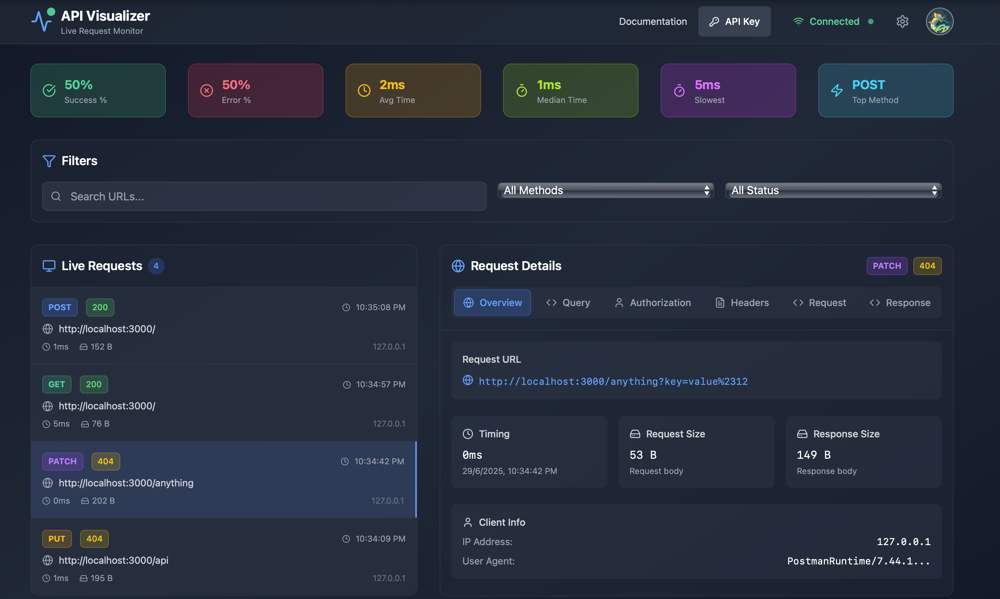

# 🚦 API Visualizer

**Monitor, capture, and debug HTTP traffic from your local development server — in real time, from anywhere.**

API Visualizer is a powerful development tool that provides live monitoring of your Express.js API requests through an intuitive web dashboard. View request/response data, headers, timing, and more with real-time WebSocket streaming.

### Access the Dashboard

1. Visit the [API Visualizer Dashboard](https://api-visualizer-nine.vercel.app/dashboard)
2. Sign in with Google
3. Generate your API key
4. Start your Express server
5. Watch your API requests appear in real-time!

## ✨ Features

### 🔍 **Live Monitoring**
- Real-time API request tracking via WebSocket
- View headers, request/response bodies, and status codes
- Monitor timing and performance metrics
- Filter requests by method, status, and search terms

### 🧪 **Debug Faster**
- Structured payload visualization with syntax highlighting
- Decoded headers and authorization details
- Clear response tracking with error highlighting
- Query parameter breakdown

### 🌐 **Remote Access**
- Access your API logs from mobile, tablet, or another laptop
- No need to run your backend on every device
- Secure API key-based authentication

### 📊 **Advanced Analytics**
- Request statistics (success rate, average response time)
- Method usage analytics
- Performance metrics (slowest requests, median time)
- Visual request count indicators

### 💾 **Flexible Data Storage**
- **History Mode Toggle**: Choose between persistent and ephemeral data
  - **Enabled**: Logs saved to database, persist across refreshes
  - **Disabled**: Frontend-only display, cleared on refresh
- Real-time log clearing functionality
- Automatic data deduplication

## 🎮 Usage

### Dashboard Features

#### 📈 **Statistics Overview**
View real-time analytics including:
- Total request count
- Success/Error percentages
- Average and median response times
- Most used HTTP methods
- Slowest request tracking

#### 🔍 **Request Filtering**
Filter your requests by:
- **HTTP Method**: GET, POST, PUT, DELETE, PATCH
- **Status Code**: 2xx Success, 3xx Redirect, 4xx Client Error, 5xx Server Error
- **Search**: Full-text search across URLs, request bodies, and responses

#### 📋 **Request Details**
Click any request to view:
- **Overview**: URL, timing, size, client info
- **Query Parameters**: Parsed URL parameters
- **Authorization**: Decoded auth headers
- **Headers**: Request and response headers
- **Request Body**: Formatted request payload
- **Response Body**: Formatted response with syntax highlighting

#### ⚙️ **Settings**
- **History Toggle**: Enable/disable database storage
- **Connection Status**: Real-time WebSocket connection indicator
- **Clear Logs**: Remove all stored request data

### History Mode

#### 🟢 **Enabled (Default)**
- Request logs are saved to MongoDB database
- Data persists across browser refreshes and sessions
- Historical data loads automatically on dashboard access
- Suitable for development sessions requiring data persistence

#### 🔴 **Disabled**
- Request logs are only stored in browser memory
- Data is cleared when refreshing the browser
- No database storage, reduced server load
- Perfect for temporary debugging sessions

## 🤝 Contributing

1. Fork the repository
2. Create a feature branch (`git checkout -b feature/amazing-feature`)
3. Commit your changes (`git commit -m 'Add amazing feature'`)
4. Push to the branch (`git push origin feature/amazing-feature`)
5. Open a Pull Request

## 📝 License

This project is licensed under the MIT License - see the [LICENSE](LICENSE) file for details.

## 👤 Author

**Krishna Singha**
- GitHub: [@krishna-singha](https://github.com/krishna-singha)
- Website: [krishnasingha.wiki](https://krishnasingha.wiki)
